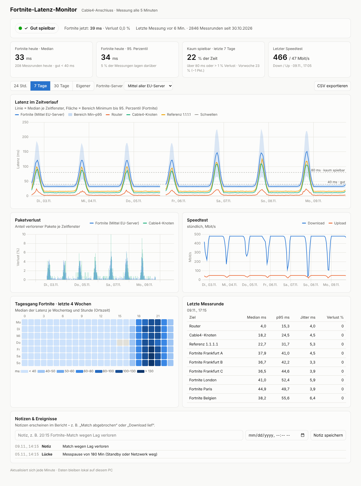

# Fortnite-Latenz-Monitor

Misst alle 5 Minuten die Latenz zu den Fortnite-Servern – mit genau dem UDP-Paket, das Fortnite selbst
für den Regions-Ping nutzt – und zum Vergleich zum eigenen Router, zum ersten Netzknoten des Providers und
zu 1.1.1.1. Einmal pro Stunde läuft ein Speedtest. Ein Dashboard zeigt Verlauf, Tagesgang und Paketverlust;
die Daten lassen sich als CSV exportieren, um sie beim Provider vorzulegen.



## Windows

[**FortniteLatenzMonitor-windows.zip** herunterladen](https://github.com/dBird2026/fortnite-latenz-monitor/releases/download/latest/FortniteLatenzMonitor-windows.zip)
(immer der aktuelle Stand), entpacken, `1_Messung_starten.cmd` doppelklicken. Keine Installation nötig.
Details: [windows/LIESMICH.txt](windows/LIESMICH.txt).

## NAS / Docker (z. B. QNAP Container Station)

Image: `ghcr.io/dbird2026/fortnite-latenz-monitor:latest` (linux/amd64)

1. Container Station → **Anwendungen** → **Erstellen**, Name `fortnite-latenz-monitor`.
2. Inhalt von [nas/docker-compose.yml](nas/docker-compose.yml) einfügen und erstellen.
3. Dashboard: `http://<NAS-IP>:8765`

Der Container läuft im Host-Netzwerk (misst also wie ein normales Gerät im Heimnetz) und speichert alles in
`/share/Container/fortnite-latenz-monitor/data`. Watchtower prüft stündlich auf ein neues Image und
aktualisiert den Monitor automatisch.

**Bestehende Daten übernehmen:** Container stoppen, `data.db` aus `%LOCALAPPDATA%\FortniteLatenzMonitor`
in den Datenordner auf der NAS kopieren, Container starten.

## Wie gemessen wird

| Ziel | Protokoll | Zeigt |
| --- | --- | --- |
| Eigener Router | ICMP | Probleme im Heimnetz |
| Erster Provider-Knoten (automatisch per traceroute) | ICMP | Engpass beim Provider |
| 1.1.1.1 | ICMP | allgemeine Internet-Qualität |
| Fortnite-Server Frankfurt, London, Paris, Belgien | UDP 22222, Epic-QoS-Format | Fortnite-relevante Latenz |

Pro Ziel und Runde 20 Pakete; gespeichert werden Min, Median, Mittel, 95. Perzentil, Max, Jitter und Verlust.
Das Epic-Paket ist 22 Byte groß: `[Nr. u16][Nr.-1 u16][Zufall u16][00 00][Zeitstempel 48 Bit][AA AA AA AA][BB BB BB BB]`;
die Server senden es unverändert zurück. Die Server-IPs stammen aus einem Mitschnitt (Nov. 2026) und stehen
in `config.toml`.

## Entwicklung

```
pip install -r requirements.txt pytest
python -m pytest -q
python -m monitor            # Messung + Dashboard
python -m monitor einmal     # eine Messrunde
python -m monitor status     # Übersicht in der Konsole
python -m monitor dashboard  # nur Dashboard
```

Jeder Push auf `main` baut über GitHub Actions das Container-Image und die Windows-Version
(Release „latest“). Ein Tag `v1.2.3` erzeugt zusätzlich ein festes Release.
